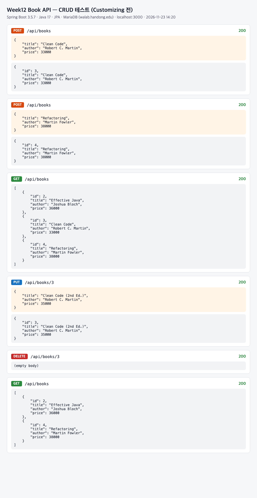
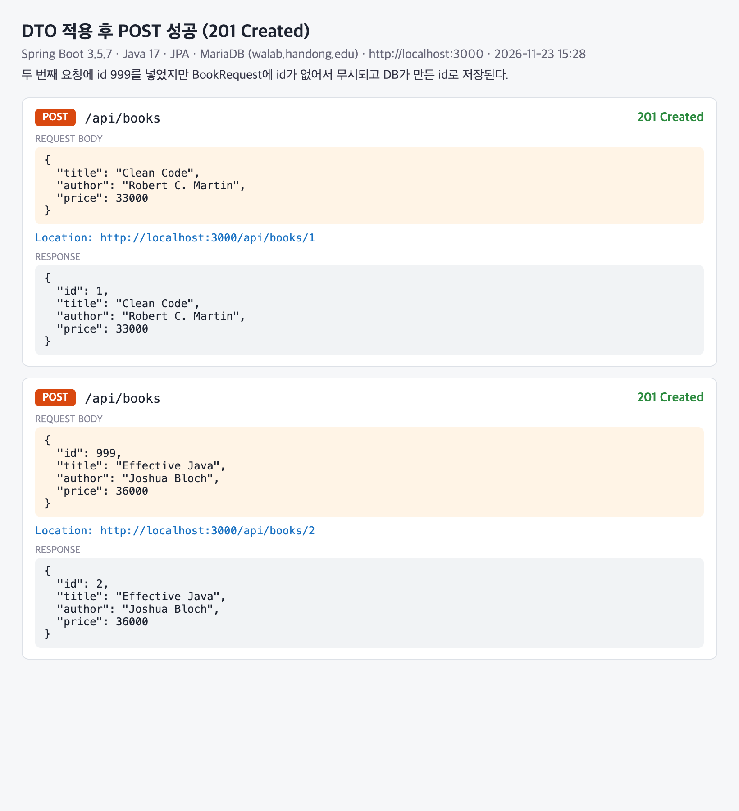
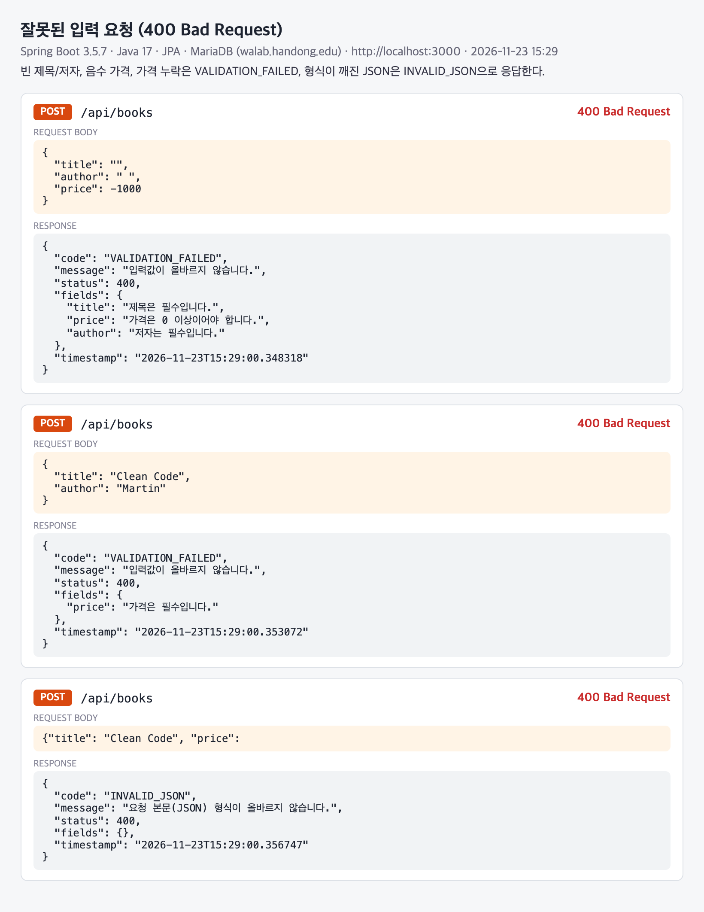
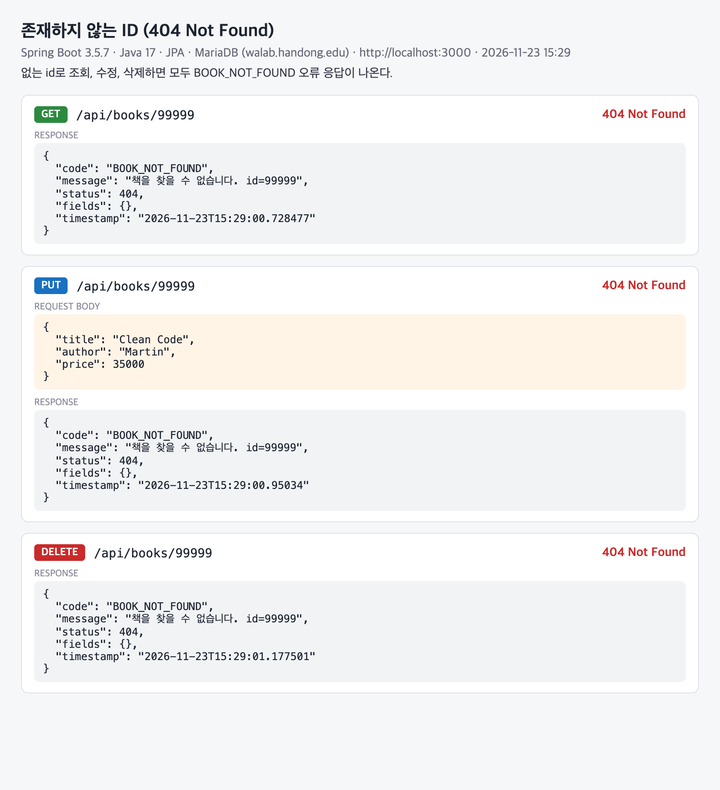
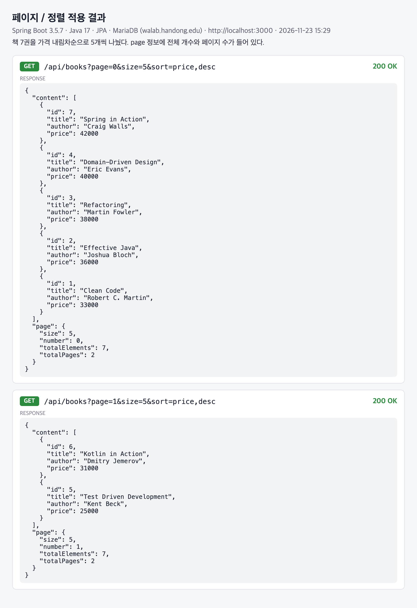
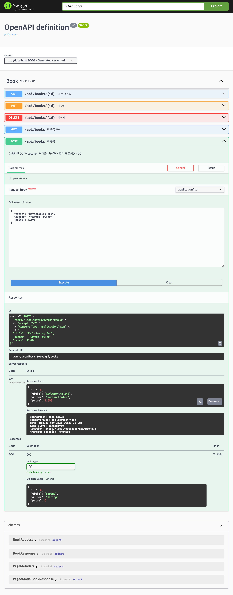
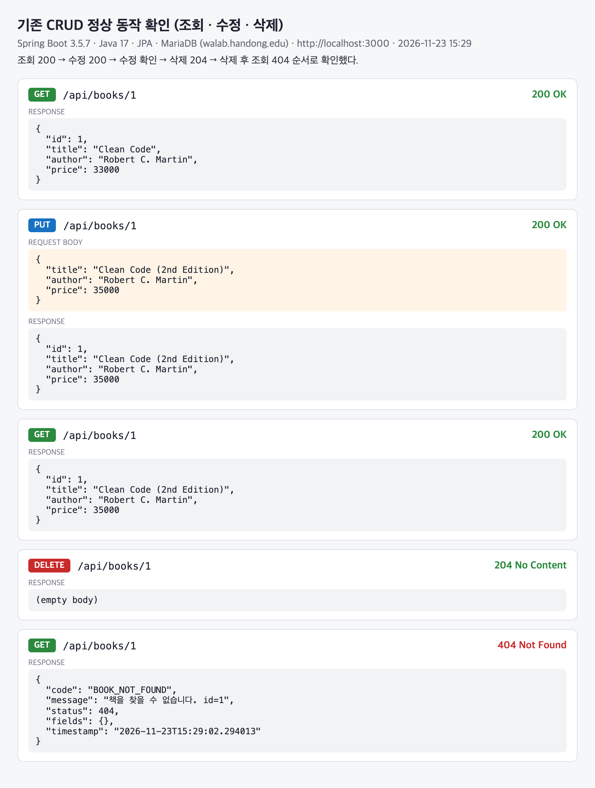

## 프로젝트 정보

### 프로젝트 소개

책 정보를 등록, 조회, 수정, 삭제하는 REST API 프로그램이다. DTO, 입력값 검사, 예외 처리, 페이지 나누기, Swagger 문서를 추가했다.

### Github URL

https://github.com/2026-2-WebService/assign12-c01-22500819

### Render URL

https://web12-glf0.onrender.com

API: https://web12-glf0.onrender.com/api/books

Swagger: https://web12-glf0.onrender.com/swagger-ui.html

## 환경설정 및 실행방법

Java 17, Spring Boot 3.5.x, MariaDB를 준비한다.

환경변수 DB_URL, DB_USERNAME, DB_PASSWORD를 자기 MariaDB에 맞게 설정한다. 설정하지 않으면 메모리 H2 DB로 실행된다.

IntelliJ에서 Week12Application의 main()을 실행하거나 ./gradlew bootRun으로 실행한다.

API 주소는 http://localhost:3000/api/books 이고, Swagger는 http://localhost:3000/swagger-ui.html 에서 볼 수 있다.

## API

GET /api/books?page=0&size=5&sort=price,desc : 책 목록 조회, 200

GET /api/books/{id} : 책 한 권 조회, 200 (없으면 404)

POST /api/books : 책 등록, 201

PUT /api/books/{id} : 책 수정, 200

DELETE /api/books/{id} : 책 삭제, 204

## 소스코드 분석

### Project Structure & JPA

#### BookController, BookService, BookRepository의 역할과 요청 처리 흐름을 설명하세요.

BookController는 /api/books로 오는 요청을 받는 곳이다. BookService는 저장, 수정, 삭제 같은 실제 기능을 처리하고, BookRepository는 DB에 접근할 때 쓴다. 요청이 오면 Controller가 Service를 부르고, Service가 Repository로 DB를 사용한다. 결과는 BookResponse로 바꿔서 응답한다.

#### JpaRepository<Book, Long>만 선언해도 findAll(), save()를 사용할 수 있는 이유를 설명하세요.

BookRepository가 상속한 JpaRepository 안에 findAll(), save() 같은 메서드가 이미 들어 있기 때문이다. Book은 다룰 Entity이고 Long은 id 타입이다. 실제 구현은 Spring Data JPA가 실행할 때 알아서 만들어준다.

### DTO & HTTP Response

#### 기존 API가 Book Entity를 직접 요청·응답에 사용할 때 발생할 수 있는 문제를 설명하세요.

Book Entity로 바로 요청을 받으면 id처럼 사용자가 보내면 안 되는 값도 들어올 수 있다. 응답할 때도 Entity 필드가 전부 나가서 숨겨야 할 정보가 보일 수 있다. 그래서 BookController에서 toBook()으로 요청을 Entity로 바꾸고, 응답은 BookResponse.from()으로 바꿔서 보낸다.

#### Request DTO와 Response DTO를 분리하는 이유와 ResponseEntity가 필요한 상황을 설명하세요.

BookRequest는 title, author, price만 받고, BookResponse는 id까지 포함해서 보여줄 값만 담는다. 받을 값과 보여줄 값이 달라서 나눴다. ResponseEntity는 상태코드나 헤더를 직접 정할 때 쓴다. create()에서 201과 Location 헤더를, delete()에서 204를 보내려고 사용했다.

### Validation & Exception Handling

#### @Valid, @NotBlank, @Min은 각각 어느 시점에 어떤 동작을 수행하나요?

@Valid는 요청 JSON이 BookRequest로 바뀐 뒤, Controller 메서드가 실행되기 전에 검사를 하게 한다. @NotBlank는 title, author가 비었는지 보고, @Min(0)은 price가 0보다 작은지 본다. @Min은 값이 없는 경우는 못 잡아서 price에 @NotNull도 붙였다. 검사에 걸리면 메서드는 실행되지 않고 400 응답이 나간다.

#### @RestControllerAdvice와 @ExceptionHandler를 사용하면 예외 처리 흐름이 어떻게 바뀌나요?

원래는 예외가 나면 Spring 기본 에러 응답이 나간다. GlobalExceptionHandler에 @RestControllerAdvice를 붙이면 Controller에서 난 예외를 한곳에서 받을 수 있다. @ExceptionHandler로 예외마다 처리할 메서드를 정해서, 책이 없으면 404, 입력값이 틀리면 400으로 응답한다. 이 경우들은 ErrorResponse 형식(code, message)으로 나가고, 따로 처리하지 않은 예외는 기본 에러 그대로 나간다.

### Pagination & OpenAPI

#### Pageable과 Page<T>는 각각 어떤 역할을 하며 sort=price,desc는 어떻게 처리되나요?

Pageable은 몇 페이지를 몇 개씩, 어떤 순서로 가져올지에 대한 정보다. Page<T>는 결과 목록과 함께 전체 개수, 전체 페이지 수를 가지고 있다. sort=price,desc를 보내면 BookService.findAll(pageable)에서 가격이 높은 순으로 정렬해서 가져온다. 아무 값도 안 보내면 list()에 정해둔 대로 5개씩 id 순으로 나온다.

#### /v3/api-docs와 /swagger-ui.html의 역할을 구분해서 설명하세요.

build.gradle에 springdoc을 추가하면 두 주소가 생긴다. /v3/api-docs는 BookController의 API 정보를 JSON으로 보여준다. /swagger-ui.html은 그 내용을 화면으로 보여주는 페이지이고, 여기서 직접 요청을 보내 테스트할 수 있다.

### 작성한 주석 메서드

BookController.create() : 입력값 검사, DTO 변환, 201 응답

BookService.findById() : DB 조회, Optional 처리, 없으면 404

BookController.list() : 페이지 요청, BookResponse로 변환

## DTO & HTTP Response 리팩터링

### 변경 내용

Controller가 Book Entity 대신 BookRequest로 요청을 받고 BookResponse로 응답하도록 바꿨다.

BookRequest에는 id가 없어서 사용자가 id를 보내도 무시된다. BookResponse에는 id, title, author, price만 담는다.

등록은 201, 조회와 수정은 200, 삭제는 204로 응답하도록 ResponseEntity를 사용했다.

### 변경 전/후 비교

처음 받은 샘플 코드와 바꾼 코드에 같은 요청을 보내서 비교했다.

등록하면 변경 전에는 200이 나왔는데, 변경 후에는 201과 함께 새 책 주소(Location)가 같이 온다.

삭제하면 변경 전에는 200이 나왔는데, 변경 후에는 204가 나온다.

요청에 id 999를 같이 보내면 변경 전에는 500 에러가 났다. Entity로 바로 받아서 id가 그대로 들어가고, save()가 999번 데이터를 수정하려고 했는데 DB에 없어서 에러가 난 것이다. 변경 후에는 id가 무시되고 새 id로 잘 저장된다.

없는 id를 조회하면 변경 전에는 500이었는데, 변경 후에는 404와 에러 메시지가 나온다.

빈 제목이나 음수 가격을 보내면 변경 전에는 그대로 저장됐는데, 변경 후에는 400과 함께 어떤 값이 틀렸는지 알려준다.

## 테스트 결과

로컬 서버를 수업 MariaDB에 연결해서 테스트했다.

### 1. 초기 Sample CRUD 테스트

### 2. DTO 적용 후 POST 성공 (201)

요청에 id를 넣어도 무시되고 새 id로 저장된다.

### 3. 잘못된 입력 요청 (400)

빈 제목, 음수 가격, 가격 누락, 깨진 JSON을 보내면 400이 나온다.

### 4. 존재하지 않는 ID (404)

없는 id로 조회, 수정, 삭제하면 404가 나온다.

### 5. 페이지/정렬 적용 결과

가격이 높은 순으로 5개씩 나눠서 나온다.

### 6. Swagger UI/API 테스트

Swagger 화면에서 책 등록을 직접 실행해서 201이 나오는 것을 확인했다.

### 7. 기존 CRUD 정상 동작 확인

조회, 수정, 삭제가 잘 되고, 삭제한 뒤 다시 조회하면 404가 나온다.

